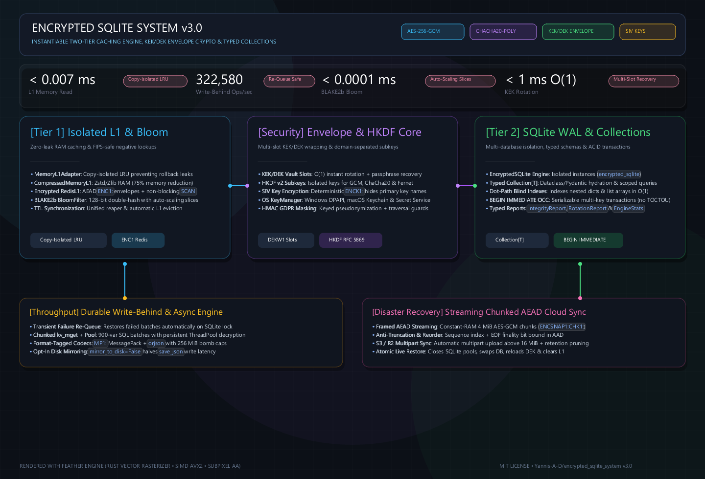
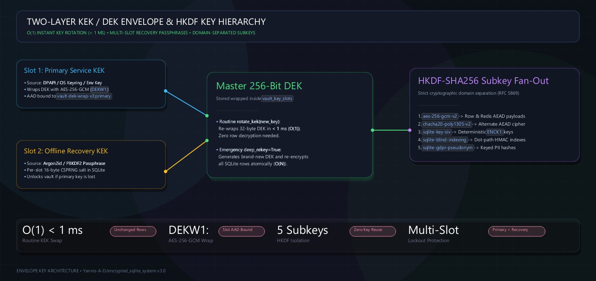
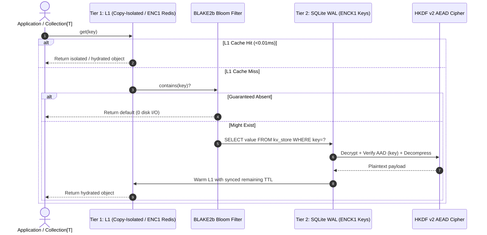
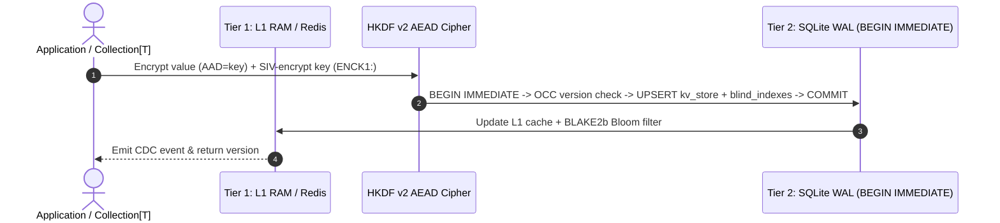

# 🏛️ Architecture & Caching Design (v3.0)

The system implements a **Two-Tier (L1/L2) Hierarchical Caching Engine** backed by **Two-Layer KEK/DEK Envelope Encryption**, **HKDF-SHA256 Domain-Separated AEAD (AES-256-GCM / ChaCha20-Poly1305)**, and **SQLite WAL Mode**.

  

---

## 📊 Latency & Storage Hierarchy

| Tier | Layer | Media | Typical Latency | Description |
| :--- | :--- | :--- | :--- | :--- |
| **Bloom Filter** | Negative Cache | System RAM | **`< 0.0001 ms`** | Auto-scaling BLAKE2b double-hash filter for 0-disk misses |
| **Tier 1 (L1)** | Application Cache | System RAM / Redis | **`< 0.01 ms`** | Copy-isolated LRU RAM, Zstd compressed RAM, or `ENC1:` encrypted Redis |
| **Tier 2 (L2)** | Persistent Store | SSD / NVMe | **`~ 0.03–1.00 ms`** | SQLite WAL + MMAP with AEAD payloads & optional `ENCK1:` SIV keys |
| **Cloud Sync** | Disaster Recovery | S3 / Cloudflare R2 | Async Background | Streaming `ENCSNAP1:CHK1:` 4 MiB chunked AEAD snapshots |

---

## 🔐 Two-Layer KEK/DEK Envelope & Multi-Slot Recovery

  

* **Data Encryption Key (DEK):** A random 256-bit key generated per vault that derives isolated HKDF-SHA256 subkeys (`aes-256-gcm-v2`, `chacha20-poly1305-v2`, `sqlite-key-siv`, `sqlite-blind-indexing`, `sqlite-gdpr-pseudonym`).
* **Key Encryption Key (KEK) Slots (`vault_key_slots`):** One or more KEKs (e.g., DPAPI/OS Keyring primary key + offline Argon2id recovery passphrase) wrap the DEK with `AES-256-GCM`.
* **O(1) Routine Key Rotation (`rotate_kek()`):** Re-wraps only the 32-byte DEK in `< 1 ms` without decrypting/re-encrypting rows. Full `deep_rekey=True` remains available for emergency DEK replacement.

---

## 🔄 Read Flow

---

## 💾 Write Flow (ACID Transaction & Write-Through)

